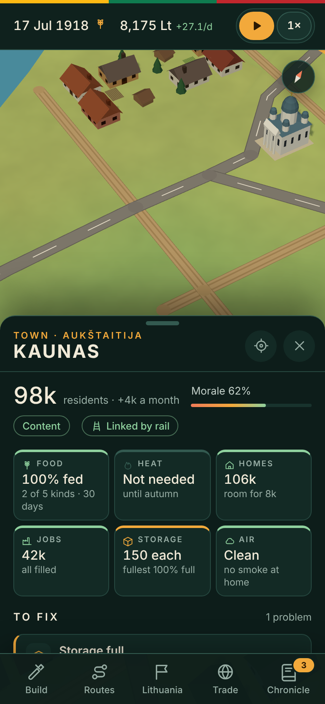

# Lietuva 1918

A 3D economy and city builder set in Lithuania from 16 February 1918, in the spirit of Workers & Resources. There is no grid: draw roads and railways as free curves across the whole country, zone lots along your streets, place farms and industry at any angle, run transport routes so 89 towns and 362 villages, each at its real place, supply each other, and trade abroad through border posts and the port. History interrupts with decisions, from the Depression to the ultimatums of 1938 to 1940; avoid the occupation if Lithuania is strong enough, or run a Soviet republic's five-year plans.



## Play

- **Online:** once GitHub Pages is switched on (see below), the game lives at `https://marcipanas.github.io/lietuva-1918/`.
- **Offline, for example on a flight:** open the online version once while connected, then install it:
  - iPhone or iPad: Safari → Share → **Add to Home Screen**.
  - Android: Chrome → menu → **Install app** (or Add to Home screen).
  - Desktop Chrome or Edge: the install icon in the address bar.
  Open it once more from the home screen while online, so every file is cached. After that it starts without a connection, in flight mode too. Your save stays on that device; on iPhone the home-screen app keeps its own save, separate from Safari's.
- **From a copy of this repository:** run `npm run serve` and open http://localhost:8080.
- The flat 2D version (v0.3) is kept on the branch `classic-2d`.

## How to play

- **First time?** A short tutorial card walks you through the first steps. Skip it any time; the Lithuania view can start it again.
- **Made for phones:** one finger always moves the map, a tap acts, and nothing is built until you press **Build**. The bar at the bottom opens five views: Build, Routes, Lithuania, Trade and Chronicle. Drag a card's handle up for more, or down to close it.
- **Look around:** drag to move, pinch to zoom, twist two fingers to turn, slide two fingers up or down to tilt. The compass turns north up again. With a mouse: wheel to zoom, right-drag to turn and tilt.
- **Tap a town** to open its card: residents and their trend, morale, six health tiles (food, heat, homes, jobs, power or storage, air), what it makes and uses each day, and its problems with a button for each fix: start a route from a neighbour with food to spare, place the farm or peat works it lacks, zone land, sell what fills the stores.
- **Lithuania** shows the whole country at a glance: residents and treasury since 1918, the goods the country makes and uses, problems by kind with the places that have them, and every town sorted by need. On the map, a red dot marks a town in trouble and an amber one a town held back.
- **Road** and **Rail:** tap where the line starts, then each place it passes, and press Build. Drag a point to move it; Undo takes one back; hold still a moment and drag to draw freehand. The line goes around lakes and buildings, bridges rivers, and joins the roads it meets. Where it follows a road that exists it uses it, and in later eras it upgrades it to the kind you pick (green on the plan). Railways need a **station** beside the track in each town.
- **Towns and villages feed themselves** from their own land and keep their size without help. To grow, they need more food, homes on zoned land, and jobs.
- **The map of 1918:** real borders, with Latvia, East Prussia, Poland and Belarus each in its own colour; the railways and paved highways of 1918; dirt roads to every village. Vilnius, Kaunas, Klaipėda, Šiauliai and Panevėžys are laid out from their real main streets, with landmarks such as Gediminas Tower, the Cathedral and the town halls. A town counts as **linked** when a railway or paved road from Vilnius reaches it.
- **Zone:** tap streets to zone lots beside them, or hold and paint. Towns build houses there while their people are fed and content.
- **Build:** pick a group, then a building: farms, fisheries, forestry, peat works, brickworks, warehouses, schools, clinics, and later power stations and factories. It appears on a good spot near the town: facing a road, on ground that suits it (lit with hatching), where a town takes it in. Drag it to move it, Turn to rotate it, Build to place it. It joins a town when a road links it to the town hall within 15 km.
- **Routes:** goods move between towns only on routes. Pick the vehicles and what they carry, or leave cargo on **Auto**. Routes can also carry commuters.
- People want **variety in food** (grain, potatoes, dairy, meat, fish) and **heating in winter** (peat or timber). Keep smoky industry 2 km away from homes.
- **Trade:** build a **border post** near the border or a **sea port**, bring goods there by route, and add deals to sell to Britain, Germany, Latvia or Poland, or to buy metal. History opens and closes markets.
- **History:** on key dates the clock stops and you decide. Each choice says whether it is what happened. Refusing an ultimatum works only with enough **security** (Lithuania view): an army budget, treaties and trade with Britain build it. Under Soviet rule Trade becomes the **Plan**: deliver the Union's yearly targets through railway stations.
- Keys: R road, T rail, Z zone, X remove, B build, Enter build, Backspace undo, Esc cancel, Space pause, 1 2 3 speed, arrows to move, + and − to zoom, [ and ] to turn, Page Up and Page Down to tilt, N for north up.

## Development

No build step and no npm packages; three.js r159 is vendored in `vendor/`. Node 18 or newer for the tools.

```bash
npm test               # static checks + headless smoke test (must pass before committing)
npm run serve          # local server on port 8080
npm run build:artifact # dist/artifact.html for publishing as a claude.ai artifact
npm run world          # rebuild js/world1918.js, the start map, after changing the map data or generator
npm run geo            # rewrite js/geo.js from tools/geo/*.json (see tools/geo/README.md)
```

- `CLAUDE.md`: rules and a code map for AI coding agents (and humans).
- `docs/ARCHITECTURE.md`: how the code fits together.
- `docs/GAME_DESIGN.md`: every mechanic and number.
- `docs/ROADMAP.md`: what comes next.
- `docs/DECISIONS.md`: why things are built the way they are.

## Deploying to GitHub Pages

1. On GitHub's free plan, Pages needs a public repository: **Settings → General → Danger Zone → Change repository visibility → Public**. With GitHub Pro the repository can stay private (the site is public either way); then delete the `if:` line in `.github/workflows/pages.yml`.
2. **Settings → Pages → Build and deployment → Source: GitHub Actions**.
3. Push to `main`, or open **Actions → Deploy to GitHub Pages → Run workflow**. The workflow runs the tests and publishes the site. While the repository is private, the deploy job is skipped.

## Notes

- Map data: borders © OpenStreetMap contributors (ODbL); coast, lakes and rivers from Natural Earth (public domain); place names and positions from Euronym, © EuroGeographics (EuroGeographics Open Data Licence); today's populations of small towns from GeoNames (CC BY 4.0). Rivers are bent onto their towns and some small rivers, soils and forests are drawn by hand, so they are approximate. Distances between places are true; towns are drawn about five times larger than life so they are visible on a country-sized map, and landmarks about twice.
- Historical dates in game events are real; where only the year is certain, the Chronicle shows the year alone. Vilnius is the capital from the start, as the Act of Independence declared, although Poland held the city from 1920 to 1939. Choices that differ from history say so.
- three.js is © three.js authors, MIT licence (`vendor/three.LICENSE`). No licence has been chosen for the game itself yet; all rights reserved by the owner until one is added.
